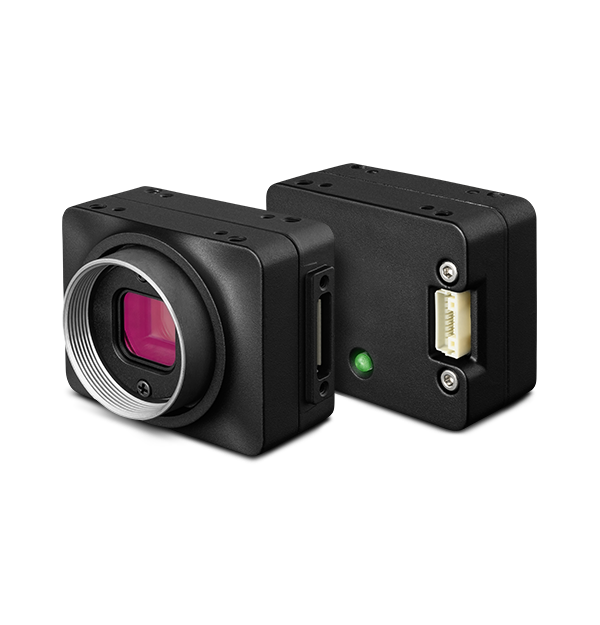

# Teledyne FLIR Chameleon lab

A live viewer for a Teledyne FLIR Chameleon CMLN-13S2M-CS on an Apple Silicon Mac. macOS lists the camera. The usual `libdc1394` install reports zero devices. This repo is the build that gets a picture, and one C file that puts it on screen.



## What this is

A Teledyne FLIR Chameleon: visible-light grayscale, USB 2.0, IIDC. Homebrew's `libdc1394` only brings up the FireWire backend, so this USB camera never appears. A source build of libdc1394 2.2.7 with IIDC-over-USB, installed beside Homebrew, fixes that. `chameleon-live` opens the first camera that library finds and draws it with SDL2.

| | |
|---|---|
| Camera | Teledyne FLIR Chameleon `CMLN-13S2M-CS` |
| Link | USB 2.0, vendor `0x1e10`, product `0x2005` |
| Image | 1280×960 grayscale, 8-bit or 16-bit |
| Lens on this bench | Computar `H6Z0812`, all mechanical |
| How it was powered | CalDigit dock, the full 500 mA the camera asks for |

The viewer grabs whichever IIDC camera comes back first. Unplug any others before you launch it.

## What you can do with it

Once the window is up, the camera is a little instrument rather than a black box:

- Watch a live 1280×960 frame, or drop to 640×480 when you want it quicker
- Switch between 8-bit and 16-bit capture. A 16-bit frame is still acquired in 16 bits and drawn as 8
- Crop on the sensor itself (640×480 or 320×240), which is different from zooming in software
- Ride shutter and gain by hand, or hand them back to auto
- Zoom, rotate, mirror, and keep a crosshair pinned to the middle of the picture
- Read a focus score while you turn the lens ring
- Save the frame the camera actually sent

The interesting failure mode, the build that avoids it, and the keys are below. The viewer and these notes are [MIT](LICENSE). libdc1394, SDL2, and libusb stay under their own licenses and are not included here.

## Quick start

Use this after libdc1394 is already installed in `~/.local/libdc1394-usb`. The first-time build is the next section.

```bash
export PKG_CONFIG_PATH="$HOME/.local/libdc1394-usb/lib/pkgconfig:$(brew --prefix libusb)/lib/pkgconfig"
export DYLD_LIBRARY_PATH="$HOME/.local/libdc1394-usb/lib"

cc -O2 chameleon-live.c \
  -o chameleon-live \
  $(pkg-config --cflags --libs libdc1394-2) \
  $(sdl2-config --cflags --libs)

./chameleon-live
```

Keep those exports in the shell you use for this project. A global `DYLD_LIBRARY_PATH` would point unrelated programs at this custom library.

## First-time setup

You need the Xcode Command Line Tools (`cc` and `make`) and Homebrew on `PATH`.

### Confirm macOS sees the camera

```bash
system_profiler SPUSBDataType | grep -i -A 15 -B 3 "Point Grey\|Chameleon"
```

A healthy cable and hub look like this. The camera's USB descriptor still says Point Grey Research, which is the string macOS and libdc1394 print. The serial number below is a placeholder. A real dump contains the unit serial, so leave that output out of git. The viewer also prints the camera GUID at startup. Leave that log out too.

```text
Chameleon CMLN-13S2M:

  Product ID: 0x2005
  Vendor ID: 0x1e10  (Point Grey Research Inc.)
  Serial Number: ...
  Speed: Up to 480 Mb/s
  Manufacturer: Point Grey Research
  Current Available (mA): 500
  Current Required (mA): 500
```

If this is empty, stop. The library cannot find a camera the USB stack has not enumerated.

On this bench the path was camera, USB 2.0 Mini-B, CalDigit dock, Mac.

### Install the libraries

```bash
brew install libusb pkgconf sdl2
```

`autoconf`, `automake`, and `libtool` are only needed if you regenerate the build system. The 2.2.7 tarball already ships `./configure`.

```bash
sdl2-config --version
pkg-config --modversion libusb-1.0
```

### Why `brew install libdc1394` is not enough

That install can succeed and still miss this camera:

```text
libdc1394 debug: Initializing platform 0: macosx
libdc1394 debug: Initialized platform 0
libdc1394 debug: Enumerating platform macosx
libdc1394 debug: Platform macosx has 0 device(s)
Found 0 dc1394 camera(s)
```

A working build brings up a second platform:

```text
Initializing platform 0: macosx
Initializing platform 1: usb
```

### Build libdc1394 2.2.7 with USB support

The install prefix is `~/.local/libdc1394-usb`, next to Homebrew rather than over it. `/tmp` is wiped on reboot, so the tree below is only for the compile and the one-shot grab test. Later sessions use the copy under `~/.local`.

```bash
cd /tmp
rm -rf libdc1394-2.2.7 libdc1394-2.2.7.tar.gz

curl -L \
  "https://downloads.sourceforge.net/project/libdc1394/libdc1394-2/2.2.7/libdc1394-2.2.7.tar.gz" \
  -o libdc1394-2.2.7.tar.gz

tar xzf libdc1394-2.2.7.tar.gz
cd libdc1394-2.2.7

export LIBUSB_PREFIX="$(brew --prefix libusb)"
export CPPFLAGS="-I${LIBUSB_PREFIX}/include"
export LDFLAGS="-L${LIBUSB_PREFIX}/lib"
export PKG_CONFIG_PATH="${LIBUSB_PREFIX}/lib/pkgconfig"

./configure --prefix="$HOME/.local/libdc1394-usb"
```

Stop if the configure summary says IIDC-over-USB is disabled. Fix the libusb paths before compiling.

```bash
make -j"$(sysctl -n hw.ncpu)"
make install
```

`~/.local/libdc1394-usb/lib` should contain `libdc1394.dylib`, `libdc1394.26.dylib`, `libdc1394.a`, `libdc1394.la`, and `pkgconfig`.

### Point the shell at that build

```bash
export PKG_CONFIG_PATH="$HOME/.local/libdc1394-usb/lib/pkgconfig:$(brew --prefix libusb)/lib/pkgconfig"
export DYLD_LIBRARY_PATH="$HOME/.local/libdc1394-usb/lib"

pkg-config --variable=prefix libdc1394-2
```

You want `/Users/<your-user>/.local/libdc1394-usb`. `/opt/homebrew/...` means the FireWire-only bottle is still the one on the link line, which is the usual reason macOS lists the camera and libdc1394 finds nothing.

### Prove the camera is visible

From the source tree, while it is still in `/tmp`:

```bash
cd /tmp/libdc1394-2.2.7
export DYLD_LIBRARY_PATH="$HOME/.local/libdc1394-usb/lib"
DC1394_DEBUG=1 ./examples/grab_gray_image
```

A good trace names the USB platform and this exact device:

```text
libdc1394 debug: Initializing platform 1: usb
libdc1394 debug: usb: Found vendor:prod 1e10:2005
libdc1394 debug: Platform usb has 1 device(s)
libdc1394 debug: Adding camera ... (Point Grey Research:Chameleon CMLN-13S2M)
```

A full 1280×960 8-bit frame is 1,228,800 bytes. When the grab works, the example writes `image.pgm`. Open it with `open image.pgm`, or `sips -s format png image.pgm --out image.png`.

Turn debug off after this. `DC1394_DEBUG=1` logs every USB bulk transfer, and it will bury the viewer if you leave it set.

### Build and run the viewer

From this repo, with the same exports set:

```bash
cc -O2 chameleon-live.c \
  -o chameleon-live \
  $(pkg-config --cflags --libs libdc1394-2) \
  $(sdl2-config --cflags --libs)

./chameleon-live
```

A clean compile is silent. `otool -L ./chameleon-live` shows whether the binary is bound to the custom libdc1394. The source includes `<SDL.h>` because `sdl2-config --cflags` already adds the SDL include directory.

## Controls

`B`, `M`, and `X` each reset digital zoom to 1x. `M` also clears a hardware crop before it toggles full and fast. Arrow keys leave auto exposure before they change a value.

### Acquisition

| Key | What it does |
|---|---|
| `B` | Toggle 8-bit and 16-bit capture |
| `M` | Toggle 1280×960 and 640×480, and turn hardware crop off |
| `X` | Cycle hardware crop: off, 640×480, 320×240, off |

Requested rates with the hardware crop off:

| Mode | Size | Rate |
|---|---|---|
| 8-bit, full | 1280×960 | 15 fps |
| 16-bit, full | 1280×960 | 7.5 fps |
| Fast, either depth | 640×480 | 30 fps |

`X` is a Format7 Mode 0 region of interest, centered on the sensor. The camera sends only that rectangle. Digital zoom is the other thing: the camera still sends the whole frame, and the Mac crops it for display.

### View

| Key | What it does |
|---|---|
| `C` | Crosshair |
| `+` / `=` / numpad `+` | Zoom in, up to 8x |
| `-` / numpad `-` | Zoom out, down to 1x |
| `1` | Reset zoom |
| Mouse wheel | Zoom |
| `R` / `L` | Rotate 90° clockwise / counter-clockwise |
| `H` / `V` | Mirror horizontal / vertical |
| `F` | Fullscreen |

The crosshair stays on the center of the window through zoom, rotation, mirroring, and a hardware crop.

### Exposure and files

| Key | What it does |
|---|---|
| `A` | Toggle auto and manual exposure |
| Up / Down | Shutter, and leave auto |
| Right / Left | Gain, and leave auto |
| `0` | Back to auto |
| `S` | Save the acquired frame as `.pgm` |
| `I` | Toggle the terminal stats |
| `Q` / `Esc` | Quit |

`S` writes the 8-bit frame after a 16-bit capture has been reduced for display, and before zoom, rotation, mirror, and the crosshair. Files land in the working directory as `chameleon-0000.pgm`, `chameleon-0001.pgm`, and so on.

The terminal line is the live readout. Shutter and gain are shown as an absolute value and the raw register:

```text
frame=450  fps=15.00  acq=FULL 1280x960  depth=MONO8  size=1280x960  dzoom=1.0x  min=0  max=255  mean=87.52  focus=26.41  shutter=12.016ms(256)  gain=0.00dB(160)  AUTO
```

## Lens and focus

The Computar `H6Z0812` has a mechanical iris, zoom, and focus. libdc1394 reporting those features as unavailable is the camera telling the truth: nothing there is electronic.

Open the iris, point at something bright, and turn the focus ring while watching `focus=` in the title bar. On the same scene and exposure, a higher number means more edge detail. Change the shutter or gain a lot and the score moves for a different reason, because noise looks like edges too.

## When it goes wrong

**macOS lists the camera and libdc1394 says zero devices.** The prefix check above should print `~/.local/libdc1394-usb`, and a debug run should show `Initializing platform 1: usb`. A missing USB platform means the process is still on a FireWire-only build.

**The picture stays black while shutter and gain sit at the top of the range.** On this camera those ranges were about shutter `0`–`1077` and gain `160`–`842`. Take the lens cap off, open the iris, and aim at a bright scene before chasing feature registers.

**`SDL.h` is missing.** Compile with `$(sdl2-config --cflags --libs)`. `sdl2-config --cflags` shows the include path the compiler should have been given.

**The terminal turns into a firehose.** Unset `DC1394_DEBUG` and start `./chameleon-live` again.

## In this repo

```text
.
├── AGENTS.md
├── LICENSE
├── README.md
├── .gitignore
├── chameleon-live.c
└── chameleon3-front-back.png
```

Agents asked to set this up and decide whether it runs should follow [AGENTS.md](AGENTS.md).

`.gitignore` keeps the `chameleon-live` binary, object files, `*.pgm` snapshots, and a local `libdc1394-*` source tree out of git.

Already in the viewer: the USB path above, live preview, both bit depths, both sizes, hardware crop, digital zoom, crosshair, rotation, mirroring, fullscreen, auto and manual exposure, FPS, min/max/mean, the focus score, PGM snapshots, and a clean Ctrl-C shutdown.

Still on the bench, unimplemented: a histogram, focus peaking, dark-frame and flat-field checks, software or GPIO trigger, strobe, a temperature readout, video recording, and a rangefinder.
